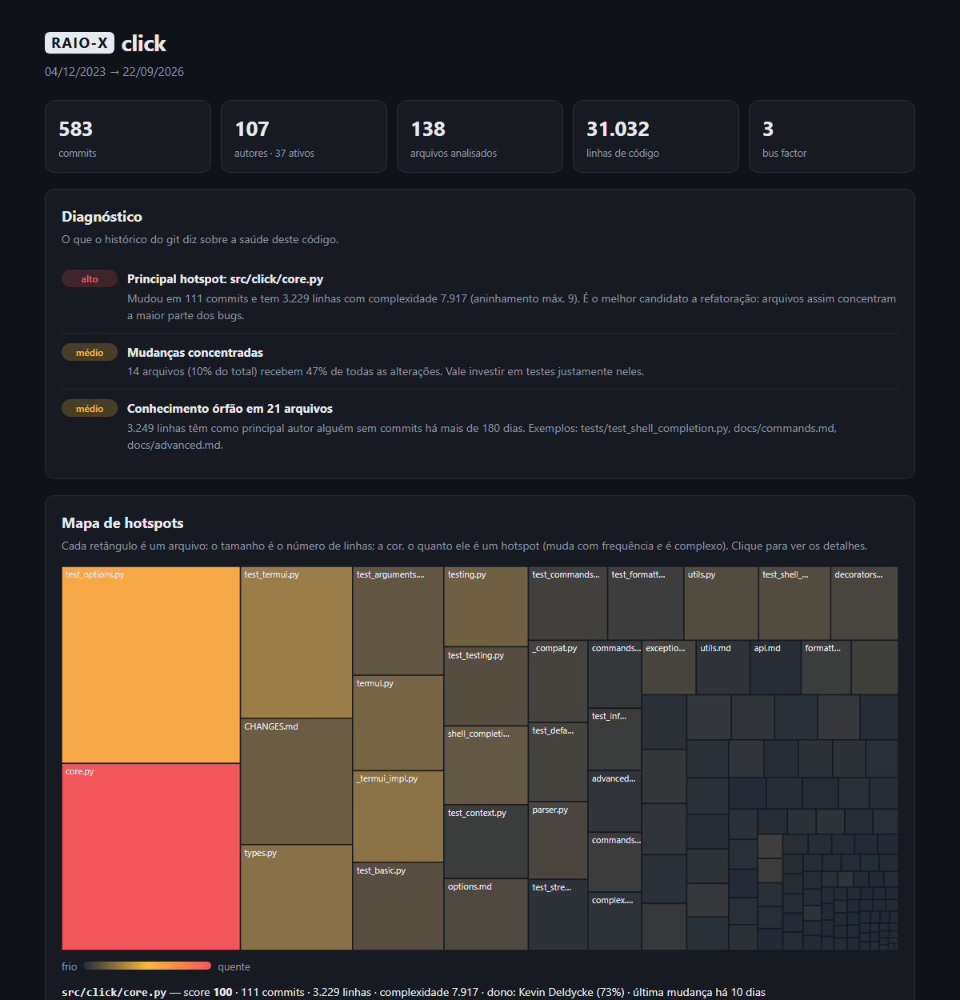

# raiox 🩻

**Um raio-X do seu repositório git.** O `raiox` lê o histórico de commits e mostra onde o código está doente:
quais arquivos concentram os bugs, quem é insubstituível no time e quais partes do sistema estão
acopladas sem ninguém perceber.

Ferramentas de análise estática olham para o código *como ele está*. O `raiox` olha para *como ele
chegou até aqui*, e o histórico revela coisas que nenhum linter vê.



## O que ele encontra

| Análise | Pergunta que responde |
|---|---|
| **Hotspots** | Quais arquivos mudam o tempo todo *e* são complexos? São eles que concentram os bugs e onde refatorar dá mais retorno. |
| **Bus factor** | Quantas pessoas precisam sair do projeto para mais da metade do código ficar sem ninguém que o conheça? |
| **Acoplamento oculto** | Quais arquivos em pastas diferentes sempre mudam no mesmo commit? É uma dependência que não aparece nos imports. |
| **Conhecimento órfão** | Qual código tem como principal autor alguém que não commita há meses? |
| **Idade do código** | Quanto do sistema é estável e quanto está em mudança constante? |

No fim, tudo vira um **diagnóstico em português**, ordenado por gravidade:

```
DIAGNÓSTICO
  ● alto   Principal hotspot: src/click/core.py
            Mudou em 111 commits e tem 3.229 linhas com complexidade 7.917 (aninhamento máx. 9).
            É o melhor candidato a refatoração: arquivos assim concentram a maior parte dos bugs.
  ● médio  Mudanças concentradas
            14 arquivos (10% do total) recebem 47% de todas as alterações.
  ● médio  Conhecimento órfão em 21 arquivos
            3.249 linhas têm como principal autor alguém sem commits há mais de 180 dias.
```

## Instalação

Precisa de Python 3.9+ e git. **Zero dependências externas.**

```bash
pip install git+https://github.com/ThiagoFernandes1/raiox
```

## Uso

```bash
raiox                                   # analisa o repositório da pasta atual
raiox ../meu-projeto --html raiox.html --open    # gera o relatório interativo e abre no navegador
raiox https://github.com/pallets/flask  # analisa qualquer repositório público pela URL
raiox --since "1 year ago"              # só o último ano
raiox --exclude "docs/*" --exclude "*.md"
raiox --json - | jq .hotspots[0]        # JSON para integrar com outras ferramentas
raiox --strict                          # retorna código 3 se houver risco alto (bom para CI)
```

Veja todas as opções com `raiox --help`.

### Relatório HTML

`--html` gera **um único arquivo** que abre em qualquer navegador, sem servidor e sem internet:

- **Mapa de hotspots** (treemap): o tamanho de cada retângulo é o número de linhas; a cor, o quanto o arquivo é um hotspot.
- Tabela de hotspots com filtro e ordenação.
- Lista de acoplamentos, com filtro para mostrar só os ocultos.
- Autores, idade do código e atividade semanal.
- Tema claro/escuro automático.

## Como funciona

**Complexidade sem parser.** Em vez de um analisador por linguagem, o `raiox` soma os níveis de indentação
de cada linha. Código cheio de `if` dentro de `for` dentro de função fica mais indentado, e essa
métrica acompanha de perto a complexidade ciclomática. Por isso funciona igual para Python, JavaScript,
Java, Go, C#, PHP...

**Score de hotspot.** A média geométrica entre a frequência de mudança e a complexidade, as duas normalizadas
pelo maior valor do repositório (0 a 100). Um arquivo só tem nota alta se for as duas coisas ao mesmo tempo.

**Bus factor.** Um autor é "dono" de um arquivo se escreveu ao menos 25% das linhas adicionadas nele. O
algoritmo (guloso, de [Avelino et al., 2016](https://arxiv.org/abs/1604.06766)) remove, um por vez, o autor
que é dono de mais arquivos, até que mais da metade dos arquivos fique sem dono.

**Acoplamento temporal.** Para cada par de arquivos, `grau = commits em comum / média de commits dos dois`.
Commits gigantes (mais de 30 arquivos, como reformatações) são ignorados porque não dizem nada sobre dependências
reais. Um par é **oculto** quando os arquivos estão em pastas diferentes e nenhum deles é teste.

**Renomeações.** O histórico segue os arquivos renomeados: se `core.py` virou `engine.py`, os commits antigos
contam para `engine.py`.

As ideias vêm principalmente de *Your Code as a Crime Scene*, de Adam Tornhill.

## Arquitetura

```
src/raiox/
├── gitlog.py       executa o git, faz o parse do log --numstat e resolve renomeações
├── complexity.py   complexidade por indentação, independente de linguagem
├── metrics.py      hotspots, bus factor, acoplamento, idade e diagnóstico
├── terminal.py     relatório colorido para o terminal
├── html_report.py  injeta os dados no template
├── template.html   relatório interativo (HTML + CSS + JS puro, treemap squarified em SVG)
└── cli.py          linha de comando
```

## Desenvolvimento

```bash
git clone https://github.com/ThiagoFernandes1/raiox && cd raiox
pip install -e .
python -m unittest discover -s tests -v
```

Os testes de ponta a ponta criam repositórios git de verdade em pastas temporárias, com autores, datas e
renomeações. O CI roda a suíte no Linux, Windows e macOS e gera o raio-X do próprio `raiox` como artefato.

## Licença

MIT
